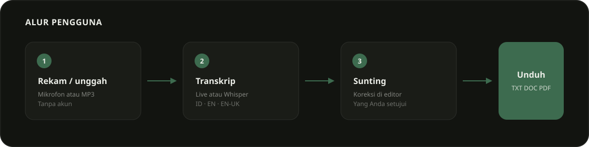
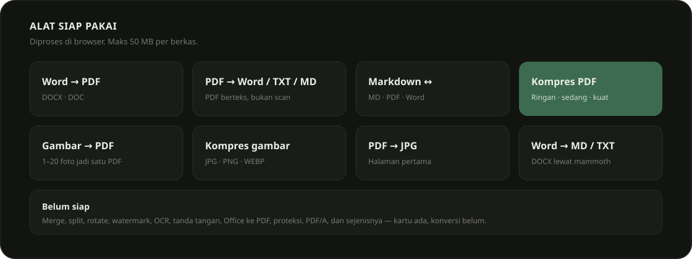
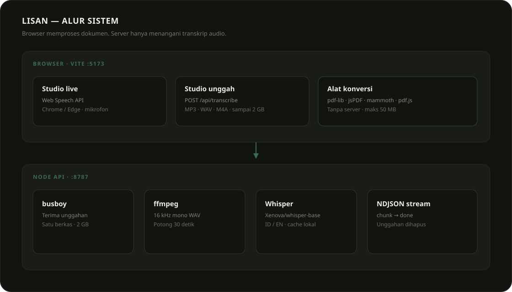

# Lisan

Rekam bicara jadi teks. Konversi PDF, Word, Markdown, dan gambar. Semua di mesin Anda.


Lisan punya dua sisi:

1. **Studio suara** — dikte live lewat mikrofon, atau unggah audio sampai 2 GB. Sunting transkrip, unduh TXT, DOC, atau PDF.
2. **Alat konversi** — Word, PDF, Markdown, gambar. Diproses di browser. Tidak ada unggahan ke server.

Tidak ada akun. Chrome atau Edge.

---

## Melihat alur pengguna



1. Rekam dari mikrofon, atau jatuhkan MP3 / WAV / M4A.
2. Transkrip muncul. Live memakai Web Speech API. Unggahan memakai Whisper di mesin lokal.
3. Koreksi di editor. Yang tersimpan hanya yang Anda setujui.
4. Unduh TXT, DOC, atau PDF. Nama berkas otomatis: `lisan-YYYYMMDD-HHMM`.

---

## Menjalankan proyek

### Prasyarat

- Node.js 20 atau lebih baru
- npm
- Chrome atau Edge (Web Speech API untuk dikte live)

### Memasang dan menjalankan

```bash
npm install
npm run dev
```

Perintah itu menjalankan dua proses:

| Proses | Alamat | Peran |
| --- | --- | --- |
| Vite | `http://localhost:5173` | UI React |
| API | `http://127.0.0.1:8787` | Transkrip audio |

Vite mem-proxy `/api` ke port 8787. Buka `http://localhost:5173`.

Jalankan terpisah jika perlu:

```bash
npm run dev:web
npm run dev:api
```

### Perintah lain

```bash
npm run check     # assert pada limits, jobs, markdown
npm run build     # tsc + vite build
npm run preview   # pratinjau hasil build
```

Model Whisper (`Xenova/whisper-base`) diunduh sekali ke `.cache/` saat unggahan audio pertama. Setelah itu jalan offline.

---

## Memakai Studio


### Dikte live

1. Buka `#studio`.
2. Izinkan mikrofon.
3. Pilih bahasa: Indonesia, English, atau English UK.
4. Klik **Rekam**. Bicara. Teks muncul saat Anda bicara.
5. Stop, sunting, unduh.

Live memakai `SpeechRecognition` / `webkitSpeechRecognition` di browser. Tanpa server. Tanpa Whisper.

### Unggah audio

Format: `.mp3`, `.wav`, `.m4a`, `.aac`, `.ogg`, `.oga`, `.webm`, `.flac`, `.opus`, `.wma`, `.mp4`. Maks **2 GB**.

1. Pilih tab unggah.
2. Jatuhkan berkas.
3. Server memotong audio 30 detik, menjalankan Whisper, mengirim potongan teks lewat NDJSON.
4. Sunting hasil, unduh.

Satu unggahan sekaligus. Kalau API sibuk, Anda dapat `429`. Folder unggahan dihapus setelah selesai, batal, atau error.

---

## Memakai alat konversi


Buka `#alat`, cari, klik kartu. Hash URL jadi halaman alat (`#word-pdf`, `#compress`, …).

Dokumen dan gambar: **maks 50 MB** per berkas. Gambar ke PDF: **1–20** berkas.



### Siap pakai

| Alat | Dari | Ke | Catatan |
| --- | --- | --- | --- |
| Word ke PDF | `.docx`, `.doc` | PDF | DOCX lewat mammoth. DOC binary lama ditolak. |
| MD ke PDF | `.md`, `.txt` | PDF | Markdown sendiri, bukan library. |
| PDF ke MD | `.pdf` | Markdown | PDF berteks. Scan gambar gagal. |
| Word ke MD | `.docx`, `.doc` | Markdown | |
| MD ke Word | `.md`, `.txt` | `.doc` | HTML Word, bukan DOCX modern. |
| Kompres PDF | `.pdf` | PDF | Kualitas: ringan, sedang, kuat. |
| PDF ke Word | `.pdf` | `.doc` | Teks saja. |
| PDF ke TXT | `.pdf` | `.txt` | |
| Word ke TXT | `.docx`, `.doc` | `.txt` | |
| Gambar ke PDF | JPG, PNG, WEBP, GIF, BMP | PDF | 1–20 gambar, satu PDF. |
| Kompres gambar | JPG, PNG, WEBP, BMP | sama | |
| PDF ke JPG | `.pdf` | JPG | Halaman pertama. |

Kompres PDF merender halaman ke JPEG lalu menyusun ulang. Kalau hasil lebih besar dari sumber, Lisan mengembalikan salinan yang di-save ulang dengan object streams.

### Belum diimplementasi

Kartu ada. Klik tetap error dengan pesan jelas:

Gabungkan / pisahkan / putar PDF, tanda air, nomor halaman, atur urutan, potong, PDF ke PowerPoint / Excel, Office ke PDF, tanda tangan, HTML ke PDF, buka kunci, proteksi, PDF/A, perbaiki, OCR, bangkan, formulir.

---

## Melihat arsitektur



```
src/                 UI React
  App.tsx            Hash router: landing atau ToolPage
  components/        Studio, ToolPage, UploadDrop, GSAP
  lib/convert.ts     Semua konversi dokumen di browser
  lib/speech.ts      Web Speech API
  lib/upload.ts      XHR + NDJSON ke API
  lib/export.ts      TXT / DOC / PDF dari transkrip

shared/              Dipakai UI dan API
  docs.ts            Daftar JobId + validasi 50 MB
  limits.ts          Validasi audio 2 GB
  md.ts              Markdown ↔ HTML
  check.ts           Assert

server/
  index.ts           HTTP :8787 — health, visitors, transcribe
  transcribe.ts      Whisper (Xenova/whisper-base)
  ffmpeg.ts          16 kHz mono, potong 30 detik
```

Konversi dokumen **tidak** lewat server. `convert.ts` memakai `pdf-lib`, `jspdf`, `mammoth`, `pdfjs-dist`. API hanya untuk audio.

---

## Memakai API

Hanya transkrip audio. Bukan konversi dokumen.

| Metode | Path | Isi |
| --- | --- | --- |
| `GET` | `/api/health` | `{ ok, busy }` |
| `GET` | `/api/visitors` | `{ count }` — hitungan di memori, reset saat restart |
| `POST` | `/api/transcribe` | `multipart/form-data`: `file`, `lang` (`id-ID` atau `en-US`) |

Respons sukses: stream `application/x-ndjson`.

```json
{"t":"stage","s":"decode"}
{"t":"chunk","i":1,"n":4,"c":"kalimat dari potongan"}
{"t":"done","text":"teks penuh"}
```

Error sebelum stream: JSON `{ "t": "error", "m": "..." }` dengan status 400 / 413 / 429 / 500.

`lang` yang diawali `id` memakai Whisper Indonesian. Selain itu: English.

Timeout server dimatikan. Berkas 2 GB butuh waktu lama.

---

## Memahami desain

Palet: tinta `#121410`, kertas `#eceee8`, lumut `#3d6b4f`. Font: Outfit Variable.

Landing memakai GSAP ScrollTrigger (judul pin, gambar scale/fade) dan marquee. `prefers-reduced-motion` mematikan pin dan animasi.

---

## Memperbaiki masalah umum

| Gejala | Perbaikan |
| --- | --- |
| Overlay Vite: `Unexpected token` di `convert.ts` | Signature `download()` hilang. Harus `function download(blob: Blob, name: string)`. |
| Live rekam tidak jalan | Pakai Chrome atau Edge. Izinkan mikrofon. |
| Unggah audio: "Jaringan gagal. Server API aktif?" | `npm run dev` (web + api), bukan `dev:web` saja. |
| `429` saat unggah | Tunggu unggahan lain selesai. Satu job. |
| PDF ke teks kosong | PDF scan. Tanpa OCR. Pakai PDF berteks. |
| DOC binary lama | Pakai DOCX. |
| Model Whisper lambat pertama kali | Unduh ke `.cache/`. Berikutnya lebih cepat. |

---

## Batas yang disengaja

- Hitungan pengunjung di memori. Hilang saat API restart.
- Satu transkrip audio bersamaan.
- Whisper `base`, bukan model besar.
- PDF teks, bukan OCR.
- Hasil Word adalah `.doc` HTML, bukan DOCX OOXML.

Tambah persistensi, antrian, atau OCR hanya saat kebutuhan itu muncul.
